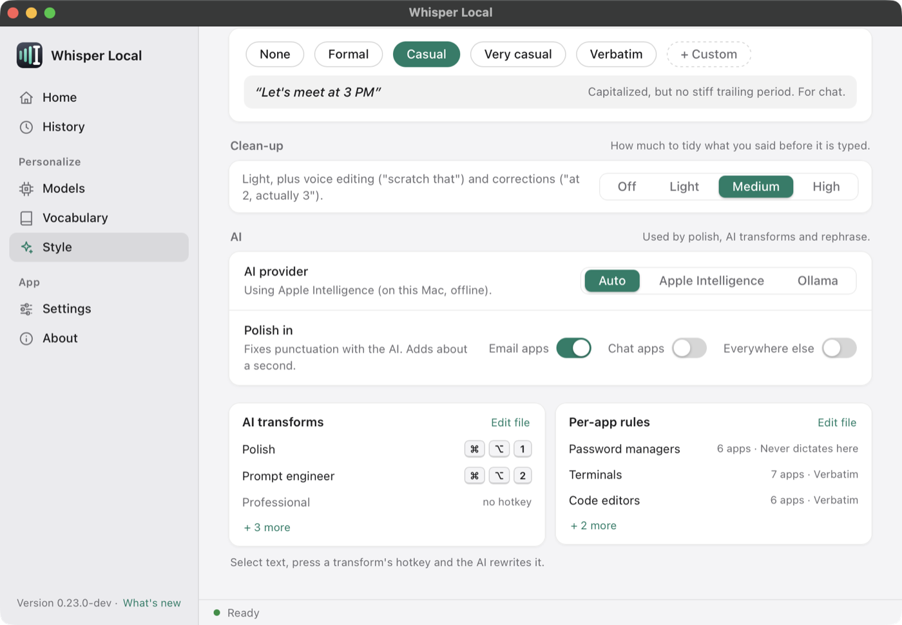
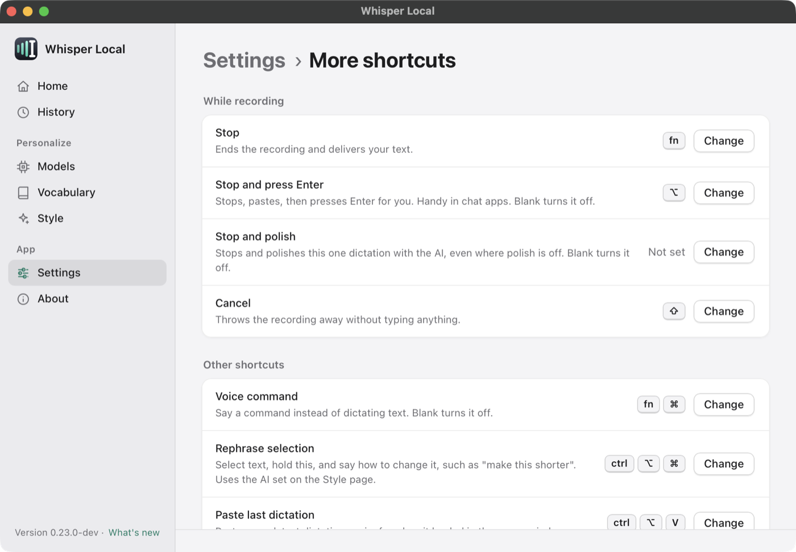

# AI polish, transforms and rephrase

Whisper Local has three features that use a small AI language model. **Polish** fixes the punctuation and capital letters of each dictation. **Transforms** rewrite selected text with a stored prompt. **Rephrase** rewrites selected text with an instruction you speak. All three run on your computer. [Back to the README](../README.md).

**Contents**

- [Choose the AI](#choose-the-ai)
- [Apple Intelligence](#apple-intelligence)
- [Ollama](#ollama)
- [Polish](#polish)
- [Stop and polish](#stop-and-polish)
- [Transforms](#transforms)
- [Rephrase](#rephrase)
- [Speed](#speed)

The AI steps are optional. Dictation works without them.

## Choose the AI

All three features use one provider. Set it on the dashboard's Style page, or with `postprocess.ai.provider`.



| Value | What happens |
|---|---|
| `auto` (default) | Uses Apple Intelligence when it is ready. If not, uses Ollama. |
| `apple_intelligence` | Uses Apple Intelligence. Falls back to Ollama when it is not available. |
| `ollama` | Always uses Ollama. |

The Style page says which AI is in use now, for example "Using Apple Intelligence (on this Mac, offline)".

## Apple Intelligence

Apple Intelligence is Apple's on-device model. It makes no network call. You need:

- A Mac with Apple silicon.
- macOS 26 or later.
- Apple Intelligence turned on in System Settings.
- Apple's Command Line Tools. Run `xcode-select --install` if you do not have them.

The app builds a small helper program once. It starts the build in the background when the app starts. It stores the helper in `~/.whisperkey/apple_intelligence/`. Until the build finishes, the app uses Ollama or skips the AI step.

The About page shows if Apple Intelligence is ready. If it is not, the row says why and has a button. The reasons are:

| Reason shown | What to do |
|---|---|
| Apple Intelligence is turned off in System Settings | Click **Open Settings** and turn it on |
| Setup needs Apple's Command Line Tools | Click **Install tools**, or run `xcode-select --install` |
| Apple Intelligence is getting ready | Wait. The app is building the helper. |
| Apple Intelligence is still downloading its model | Wait for macOS to finish |
| Needs macOS 26 or later, or Apple silicon | Use Ollama instead |
| This Mac does not support Apple Intelligence | Use Ollama instead |

`whisper-local --doctor` prints the same reason.

## Ollama

[Ollama](https://ollama.com) runs open language models on your computer. Use it when Apple Intelligence is not available, or when you prefer it. The app sends text to the Ollama server that you set. The default is `localhost`.

```yaml
postprocess:
  ollama:
    endpoint: http://localhost:11434
    model: llama3.2        # pull it first: ollama pull llama3.2
    timeout: 5             # seconds to wait for polish
```

Choose **Ollama** on the Style page to edit the server, model and timeout. The app checks the address before it saves it. Start the server with `ollama serve`. If Ollama does not answer, the app shows "Rephrase failed: Ollama did not answer" or types your original text.

## Polish

Polish sends each dictation to the AI. The AI fixes punctuation and capital letters. It must not change the words.

Polish is **off** by default, with one exception: email apps polish by default when an AI is available. The "Polish in" row on the Style page has three switches.

| Switch | What it controls |
|---|---|
| Email apps | The `email-clients` rule. On by default. |
| Chat apps | The `chat-apps` rule. Off by default. |
| Everywhere else | `postprocess.ai.polish`. Off by default. |

To set polish for one app, add `polish: true` or `polish: false` to a rule in `app_rules.yaml`. See [Per-app rules](per-app-rules.md).

### The word check

A language model sometimes rewrites text, or answers a question that you dictated. The app checks every polished result against your original words. It types your **original text** when:

- Fewer than 80 percent of your words are still in the result.
- The result has more than 10 percent new words.
- The result is more than 1.5 times as long as the original.
- The AI refuses, fails or times out.

The app also skips polish for dictations over 1200 characters. The model is slower and changes more on long text.

Polish does not apply to transforms and rephrase. You ask for a rewrite there, so the app does not check the result against the original.

### Settings

```yaml
postprocess:
  ai:
    provider: auto        # auto | apple_intelligence | ollama
    polish: false         # true polishes every dictation
    polish_prompt: |-     # {text} is replaced by the dictation
      Polish this dictation. Fix punctuation and capitalization only. Do not change wording or add anything. Output ONLY the polished text:

      {text}
```

Capitalization, end punctuation and filler-word removal work without any AI. See [Configuration](configuration.md).

## Stop and polish

This key stops the recording and polishes **that one dictation**. It works when polish is off. It also works in apps where a rule turns polish off.

Set it in **Settings > More shortcuts > Stop and polish**, or set `hotkey.stop_polish_key`. The key is **off** by default, because every simple key already has a use. If the AI cannot answer, the app types your original text and shows a notice with the reason.



## Transforms

A transform rewrites the text you selected. You select text in any app, press the transform's hotkey, and the rewrite replaces the selection. If nothing is selected, the app uses the clipboard.

These transforms ship with the app.

| Name | What it does | Default hotkey |
|---|---|---|
| `polish` | Improves clarity and fixes grammar | `win+alt+1` |
| `prompt-engineer` | Turns a dictation into a clear prompt for an AI assistant | `win+alt+2` |
| `professional` | Rewrites in a professional tone | none |
| `casual` | Rewrites in a casual tone | none |
| `bullets` | Turns prose into a bullet list | none |
| `expand` | Expands a short note into a paragraph | none |

**macOS note.** On a Mac, `win` means the Command key. So `win+alt+1` is ⌘⌥1, as the dashboard shows it.

Add your own in `transforms.yaml` in `~/.whisperkey`. Your file lays over the shipped transforms. It reloads when you save it.

```yaml
transforms:
  - name: shorten
    description: Cut it in half
    hotkey: "option+7"
    prompt: "Rewrite this in half the words. Output only the result:"
  - name: expand
    disabled: true          # turn off a shipped transform
```

A transform can also set `model` and `timeout`. They apply to the Ollama call for that transform.

## Rephrase

Rephrase changes selected text with an instruction that you speak.

1. Select text in any app.
2. Hold the rephrase hotkey. The default on macOS is `ctrl+option+command`.
3. Say what to do, for example "make this shorter".
4. Release the key. The result replaces the selection.

Set the key with `hotkey.rephrase_hotkey`. Leave it empty to turn rephrase off. If the AI does not answer, the app shows "Rephrase failed" and leaves your text alone.

## Speed

In a proof of concept on the maintainer's Mac (Apple silicon, macOS 26), calls took 0.6 to 1.4 seconds. The median was about 0.7 seconds. Your Mac may differ. Polish adds this time to every dictation where it is on. The app waits at most 10 seconds for a polish and 30 seconds for a rewrite from Apple Intelligence.
