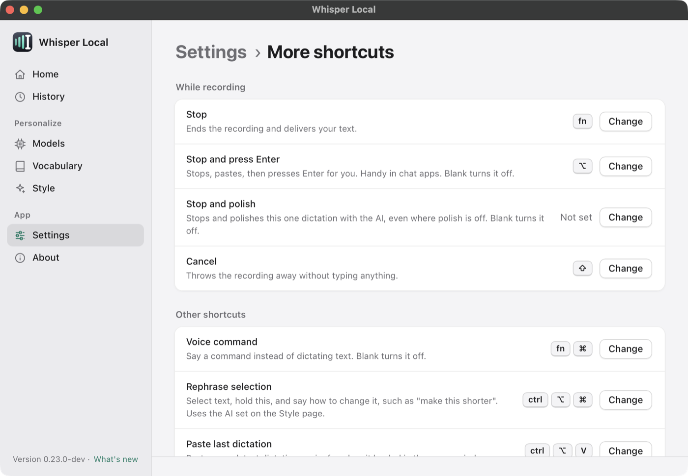

# AI polish and rephrase

Whisper Local has two features that use a small AI language model. **Polish** cleans up each dictation: it removes filler words, repeats and false starts, and fixes punctuation and capital letters. **Rephrase** rewrites selected text with an instruction you speak. Both run on your computer. [Back to the README](../README.md).

**Contents**

- [Choose the AI](#choose-the-ai)
- [Apple Intelligence](#apple-intelligence)
- [Ollama](#ollama)
- [Polish](#polish)
- [Stop and polish](#stop-and-polish)
- [Rephrase](#rephrase)
- [Speed](#speed)

The AI steps are optional. Dictation works without them.

## Choose the AI

Both features use one provider. Set it on the dashboard's Style page, or with `postprocess.ai.provider`.

| Value | What happens |
|---|---|
| `auto` (default) | Uses Apple Intelligence when it is ready. If not, uses Ollama. |
| `apple_intelligence` | Uses Apple Intelligence. Falls back to Ollama when it is not available. |
| `ollama` | Always uses Ollama. |

The Style page says which AI is in use now, for example "Using Apple Intelligence (on this Mac, offline)".

## Apple Intelligence

Apple Intelligence is Apple's on-device model. It makes no network call. You need:

- A Mac with Apple silicon.
- macOS 26 or later.
- Apple Intelligence turned on in System Settings.
- Apple's Command Line Tools. Run `xcode-select --install` if you do not have them.

The app builds a small helper program once. It starts the build in the background when the app starts. It stores the helper in `~/.whisperkey/apple_intelligence/`. Until the build finishes, the app uses Ollama or skips the AI step.

The About page shows if Apple Intelligence is ready. If it is not, the row says why and has a button. The reasons are:

| Reason shown | What to do |
|---|---|
| Apple Intelligence is turned off in System Settings | Click **Open Settings** and turn it on |
| Setup needs Apple's Command Line Tools | Click **Install tools**, or run `xcode-select --install` |
| Apple Intelligence is getting ready | Wait. The app is building the helper. |
| Apple Intelligence is still downloading its model | Wait for macOS to finish |
| Needs macOS 26 or later, or Apple silicon | Use Ollama instead |
| This Mac does not support Apple Intelligence | Use Ollama instead |

`whisper-local --doctor` prints the same reason.

## Ollama

[Ollama](https://ollama.com) runs open language models on your computer. Use it when Apple Intelligence is not available, or when you prefer it. The app sends text to the Ollama server that you set. The default is `localhost`.

```yaml
postprocess:
  ollama:
    endpoint: http://localhost:11434
    model: llama3.2        # pull it first: ollama pull llama3.2
    timeout: 5             # seconds to wait for polish
```

Choose **Ollama** on the Style page to edit the server, model and timeout. The app checks the address before it saves it. Start the server with `ollama serve`. If Ollama does not answer, the app shows "Rephrase failed: Ollama did not answer" or types your original text.

## Polish

Polish sends each dictation to the AI. The AI does these steps:

1. It removes filler words ("um", "uh", "you know"), stutters and repeated phrases.
2. It removes false starts. When you correct yourself, it keeps only the correction: "meet on tuesday no wait wednesday" becomes "Meet on Wednesday."
3. It fixes punctuation and capital letters.

The AI can only remove words. It must not add, move or change words.

With Apple Intelligence, the app starts to load the model when you push the hotkey. Usually the model is ready when you stop talking. A sentence takes about 0.5 seconds. A long paragraph takes about 3 seconds.

Polish is **off** by default. It is one switch for every app: **AI polish** on the Style page, or `postprocess.ai.polish: true`.

### The word check

A language model sometimes rewrites text, or answers a question that you dictated. The app checks every polished result against your original words. It types your **original text** when:

- The result has a word that is not in your dictation, or a word in a different order. The limit is 5 percent of your words. For short dictations, the limit is zero.
- Fewer than half of your words are still in the result. A result that short is a summary, not a cleanup.
- A negative word in your dictation ("not", "never", "don't", "can't") is not in the result. A lost "not" changes the meaning.
- The AI refuses or fails.
- The AI does not answer in time. Apple Intelligence gets 3 seconds plus 1 second for each 200 characters.

The check cannot find a removed clause when enough words stay. For example, "ship on Friday if the tests pass" can become "Ship on Friday." The prompt tells the AI not to do this.

The app also skips polish for dictations over 1200 characters. The model is slower and changes more on long text.

Polish does not apply to rephrase. You ask for a rewrite there, so the app does not check the result against the original.

### Settings

```yaml
postprocess:
  ai:
    provider: auto        # auto | apple_intelligence | ollama
    polish: false         # true polishes every dictation
    polish_prompt: |-     # {text} is replaced by the dictation
      Polish this dictation. Fix punctuation and capitalization only. Do not change wording or add anything. Output ONLY the polished text:

      {text}
```

Capitalization, end punctuation and filler-word removal work without any AI. See [Configuration](configuration.md).

## Stop and polish

This key stops the recording and polishes **that one dictation**. It works when polish is off.

Set it in **Settings > More shortcuts > Stop and polish**, or set `hotkey.stop_polish_key`. The key is **off** by default, because every simple key already has a use. If the AI cannot answer, the app types your original text and shows a notice with the reason.



## Rephrase

Rephrase changes selected text with an instruction that you speak.

1. Select text in any app.
2. Hold the rephrase hotkey. The default on macOS is `ctrl+option+command`.
3. Say what to do, for example "make this shorter".
4. Release the key. The result replaces the selection.

Set the key with `hotkey.rephrase_hotkey`. Leave it empty to turn rephrase off. If the AI does not answer, the app shows "Rephrase failed" and leaves your text alone.

## Speed

In a proof of concept on the maintainer's Mac (Apple silicon, macOS 26), calls took 0.6 to 1.4 seconds. The median was about 0.7 seconds. Your Mac may differ. Polish adds this time to every dictation where it is on. The app waits at most 10 seconds for a polish and 30 seconds for a rewrite from Apple Intelligence.
