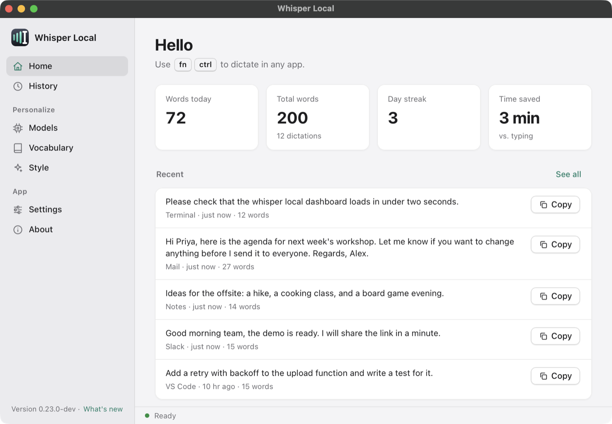
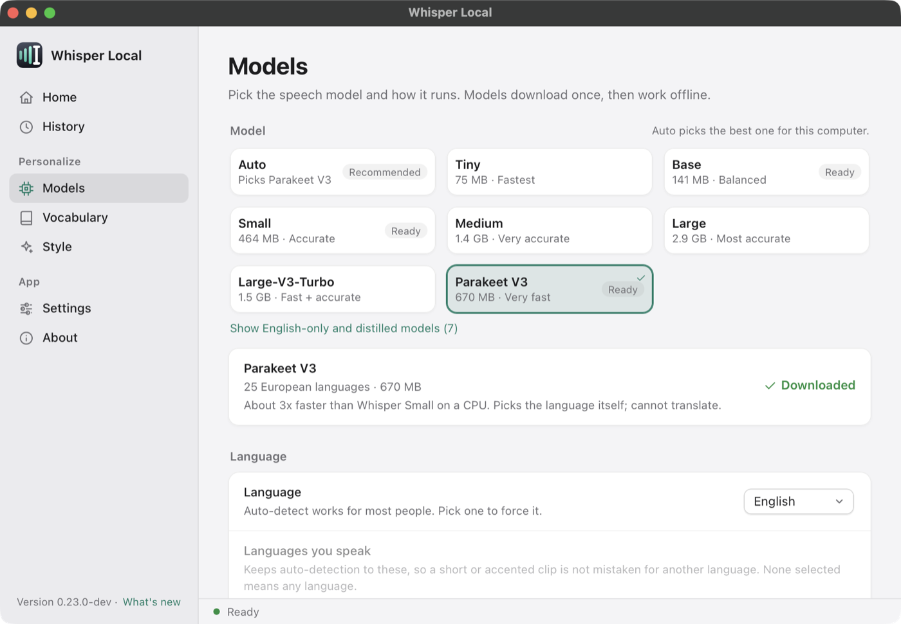
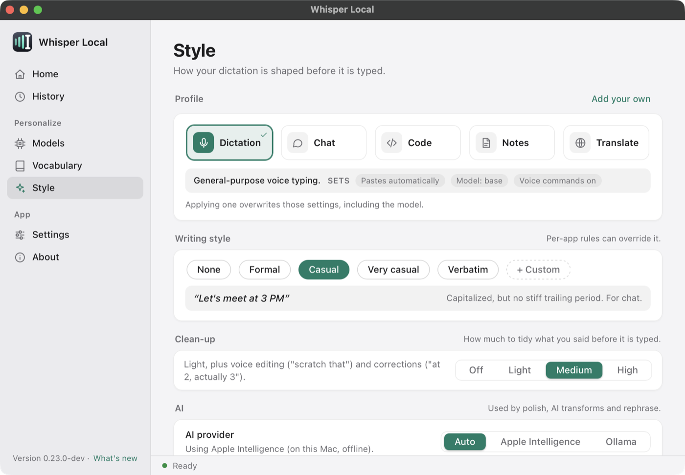
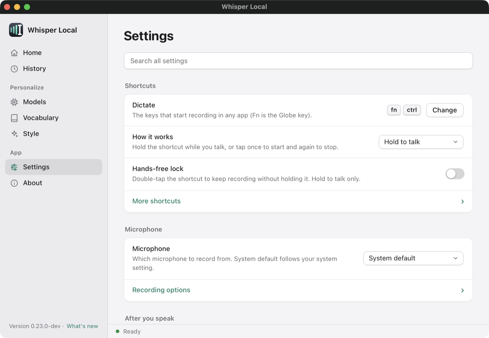
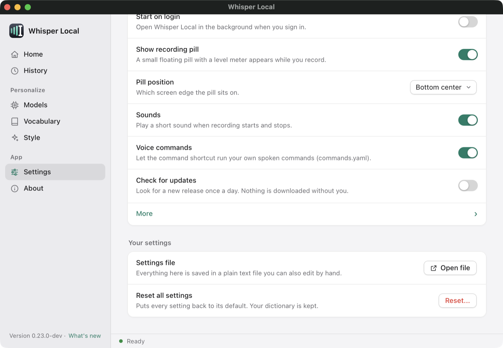
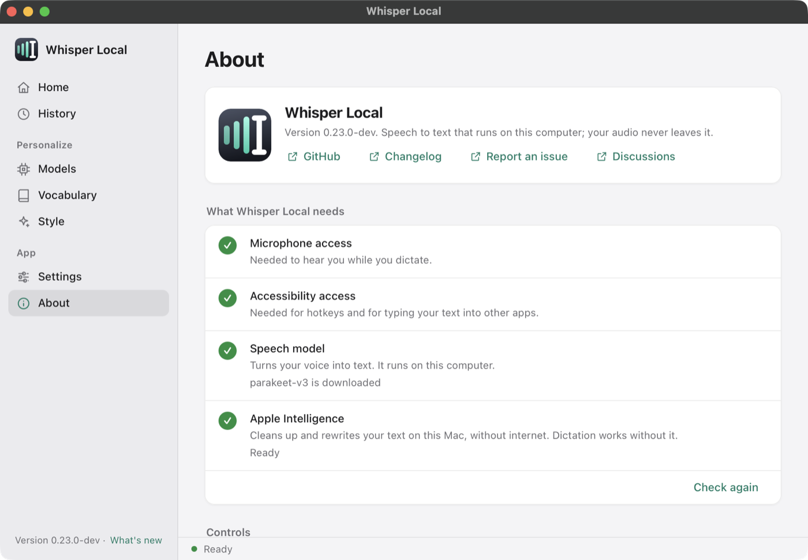

# Dashboard

The dashboard is one window with a sidebar. It has seven pages and a status bar. You change settings here, so you do not need to edit YAML files. [Back to the README](../README.md).

**Contents**

- [Open the dashboard](#open-the-dashboard)
- [The status bar](#the-status-bar)
- [Home](#home)
- [History](#history)
- [Models](#models)
- [Vocabulary](#vocabulary)
- [Style](#style)
- [Settings](#settings)
- [About](#about)

## Open the dashboard

- Click the menu bar icon, then **Open Whisper Local**.
- Run `whisper-local --settings` to open it on Settings.
- Run `whisper-local --history` to open it on History.
- Run `whisper-local --cheat-sheet` to open it on About.

The dashboard runs in its own process. It never blocks the menu bar icon or your dictation. When you quit the app, the dashboard closes.

## The status bar

The bar at the bottom of the window shows what the app is doing now. It uses the same state as the menu bar icon.

| State | What you see |
|---|---|
| Ready |  |
| Listening |  |
| Sleeping |  |

"Transcribing..." shows while the app turns your recording into text. "Sleeping" means the idle timeout unloaded the model. Your next dictation loads it again. See [idle unload](models.md#free-memory-when-idle). The bar also shows short messages, such as "Saved". They fade back to the state after a few seconds.

If you open the dashboard without the app (for example with `--window dashboard`), the bar stays empty and the Restart and Retry buttons cannot reach the app.

## Home

- A greeting and your record shortcut.
- Four numbers: words today, total words, day streak, and time saved compared with typing. The time estimate uses `stats.typing_wpm`.
- Your five most recent dictations, each with a **Copy** button. **See all** opens History.
- **Your hotkeys**, a list of your current shortcuts. See [Hotkeys](hotkeys.md).

## History

Search your past dictations, copy them, delete them, fix a misheard word, or export them. Details are in [History and vocabulary](history-and-vocabulary.md#history).

## Models

Pick the speech model with one click. The page also sets the language, the languages you speak, CPU or GPU, and idle unload. Each tile shows the size and whether the model is ready on disk. Details are in [Models](models.md).

## Vocabulary

Three cards. **Words** are hotwords that help the model spell names and jargon. **Replacements** fix text after transcription. **Snippets** expand a spoken trigger into longer text. **Heard often** suggests words from your history. Changes save at once and apply to your next dictation. Details are in [History and vocabulary](history-and-vocabulary.md#vocabulary).

## Style

How your dictation is shaped before it is typed.

- **Profile.** Dictation, Chat, Code, Notes or Translate. A profile overwrites some settings, including the model.
- **Writing style.** None, Formal, Casual, Very casual, Verbatim, or your own.
- **Clean-up.** Off, Light, Medium or High.
- **AI.** The provider, and where polish is on. See [AI polish](ai-polish.md).
- **AI transforms** and **Per-app rules.** Each card has an **Edit file** link.

Details are in [Per-app rules](per-app-rules.md) and [AI polish](ai-polish.md).

## Settings

The top level is short. Use the search box to find any setting.

| Section | Contains |
|---|---|
| Shortcuts | Your record shortcut, hold or tap mode, hands-free lock. **More shortcuts** opens the rest. |
| Microphone | Which microphone to use. **Recording options** has noise reduction, whisper mode, silence stop and speech detection. |
| After you speak | Paste automatically, keep my clipboard. **Formatting** has punctuation, capitals and delivery. |
| App | Start on login, the recording pill and its position, sounds, voice commands, update check. **More** has history retention, logs and live preview. |
| Your settings | **Open file** opens `user_settings.yaml`. **Reset...** puts every setting back to its default. Your dictionary is kept. |

All hotkeys are in [Hotkeys](hotkeys.md). All settings are in [Configuration](configuration.md).

## About

- The version and links to GitHub, the changelog, bug reports and discussions.
- **What Whisper Local needs**, a checklist. See [Getting started](getting-started.md#the-what-whisper-local-needs-checklist).
- **Controls.** **Restart** reloads settings and the model. **Retry** transcribes your last recording again with the current model. The result opens in a small window, and the app copies it to your clipboard when that is allowed. **Pause / resume** switches every hotkey off or on.
- **Diagnostics.** Health check (`--doctor`), self-test, bundle logs, a usage summary, the log file and the config folder.
- **Hotkey cheat sheet.** Every shortcut and its current keys.
