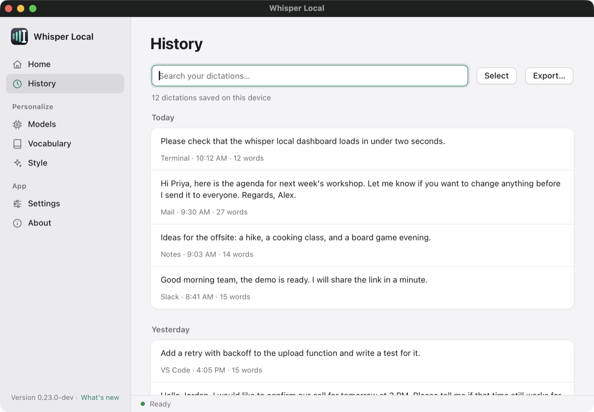
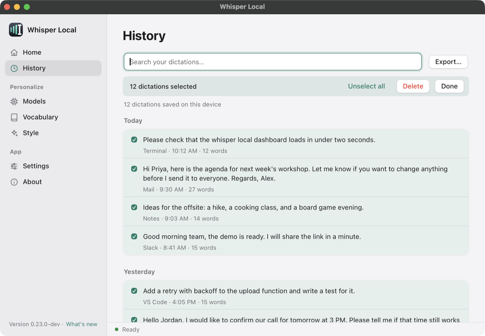
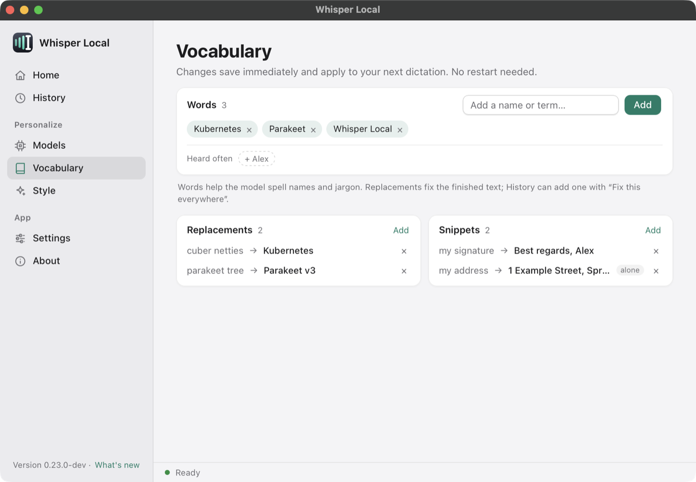

# History and vocabulary

The History page keeps a searchable list of what you dictated. The Vocabulary page teaches the app your words. Both live in the dashboard and work offline. [Back to the README](../README.md).

**Contents**

- [History](#history)
- [Delete many dictations at once](#delete-many-dictations-at-once)
- [Fix this everywhere](#fix-this-everywhere)
- [Export](#export)
- [How long history is kept](#how-long-history-is-kept)
- [Vocabulary](#vocabulary)
- [Hotwords](#hotwords)
- [Replacements](#replacements)
- [Snippets](#snippets)

## History



- Type in the search box to filter your dictations. The matching text is highlighted.
- The list groups dictations by day (Today, Yesterday, then dates). Each row shows the app, the time and the word count.
- Click the text of a row to expand a long dictation.
- Point at a row to see its buttons: **Copy**, **Fix this everywhere...** and **Delete**.
- **Delete** needs a second click on the same button. The app cannot recover a deleted dictation.
- The page loads 200 dictations at a time. Click **Load more** for older ones.

Open the page from the sidebar, or run `whisper-local --history`.

## Delete many dictations at once

1. Click **Select**. Each row gets a checkbox.
2. Click rows to pick them. Or click **Select all**. **Select all** includes the dictations that are not loaded yet, and it follows your search. A search for "invoice" followed by **Select all** picks every dictation with "invoice" in it.
3. The button then reads **Unselect all**. Click it to clear the choice.
4. Click **Delete**. The button changes to "Click again to delete N". Click it a second time within three seconds to confirm.
5. Click **Done** to leave select mode.



## Fix this everywhere

Whisper sometimes hears a name or a term wrong. Click **Fix this everywhere...** on a row. Two boxes open. Enter the text that is wrong and what you meant. Click **Save fix**.

The fix is a whole-word, case-insensitive replacement. It applies to your next dictations, with no restart. It also appears on the Vocabulary page under **Replacements**, where you can remove it.

## Export

Click **Export...** to save the dictations that match your search. The save dialog offers Markdown (`.md`) or text (`.txt`).

From the terminal, `whisper-local --export-transcripts FILE` writes `.txt`, `.md` or `.csv`, by the file name you give.

## How long history is kept

The app stores your text in `~/.whisperkey/transcripts.jsonl`. It keeps the newest 2000 dictations. Set **Settings > App > More > Keep history for**, or `history.retention_days`:

| Value | What happens |
|---|---|
| empty (default) | Keep the newest 2000 dictations |
| `7` | Delete dictations older than 7 days |
| `0` | Store no text. The History page stays empty. |

Usage numbers (counts and durations, never text) are kept in `stats.jsonl` either way. Delete the files in `~/.whisperkey` at any time to remove them.

## Vocabulary



The page has three cards. Changes save at once and apply to your next dictation. You do not need to restart.

## Hotwords

Hotwords are names and terms that you want the model to spell right. The **Words** card shows them as chips. Type a word in the box and click **Add**. Click the x on a chip to remove it.

The **Heard often** row suggests words from your own history. Click one to add it.

Hotwords work with Whisper and with Parakeet. For example, a name that Parakeet got wrong without a hotword came out right with it.

From the terminal:

```bash
whisper-local --add-word "Kubernetes"
whisper-local --remove-word "Kubernetes"
whisper-local --list-dictionary
whisper-local --import-vocab ~/Documents/notes     # find terms in a folder of text files
```

The words are stored in `whisper.hotwords` in `user_settings.yaml`.

## Replacements

A replacement fixes text **after** the model finishes. Use it for a misrecognition that happens again and again, when a hotword is not enough.

```yaml
postprocess:
  replacements:
    - from: cuber netties
      to: Kubernetes
```

An entry matches whole words and ignores case. It also accepts `whole_word`, `case_sensitive` and `regex`. The shortcut for most people is the **Fix this everywhere...** button on the History page.

If the model mishears one term in several ways, use `postprocess.corrections`. You write the right spelling once and list what you hear. The longest variant wins. The app applies all variants in one pass.

```yaml
postprocess:
  corrections:
    CAPEX: [cap x, copics]
    MySQL: [my sequel]
```

## Snippets

A snippet expands a short spoken trigger into longer text, in the middle of a normal dictation. Say "my signature" and the app types the full sign-off.

The **Snippets** card on the Vocabulary page adds and removes them. In YAML:

```yaml
postprocess:
  snippets:
    - trigger: my signature
      expansion: "Best regards,\nAlex"
    - trigger: my address
      expansion: "1 Example Street, Springfield"
      mode: alone          # only when this is the whole dictation
```

The default mode is `anywhere`. An expansion can hold `${date}` (as 2026-10-28), `${time}` (as 14:30) and `${clipboard}`. The app replaces them when it expands the snippet.
