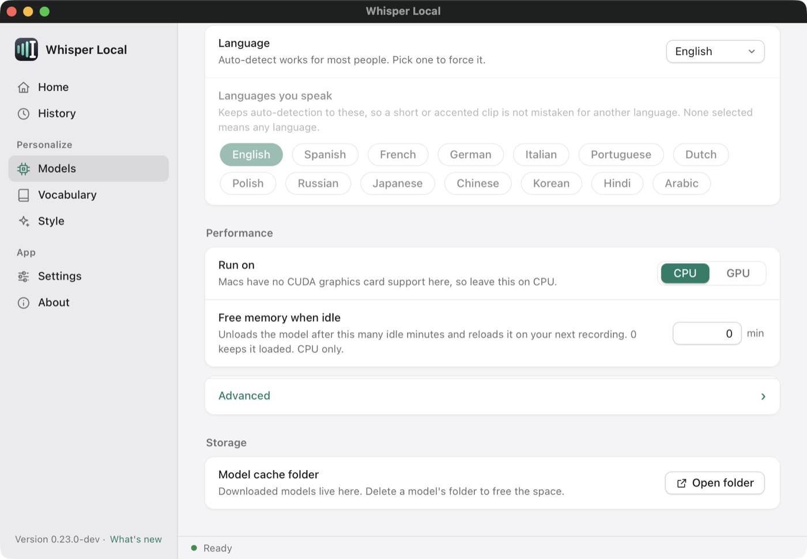

# Models

A speech model turns your voice into text. Whisper Local downloads a model once, then runs it on your computer. This page explains how the app chooses a model, what the choices are, and how to save memory. [Back to the README](../README.md).

**Contents**

- [The Models page](#the-models-page)
- [Auto model choice](#auto-model-choice)
- [Whisper sizes](#whisper-sizes)
- [Parakeet v3](#parakeet-v3)
- [whisper.cpp](#whispercpp)
- [Language](#language)
- [Free memory when idle](#free-memory-when-idle)
- [GPU](#gpu)
- [Offline models](#offline-models)
- [Live preview](#live-preview)

## The Models page


Click a tile to pick a model. A tile shows the size and a **Ready** badge when the files are on disk. If a model is not on disk, the details strip below the tiles has a **Download** button and shows progress. **Show English-only and distilled models** lists more. The lower part of the page has language, performance and storage settings.



## Auto model choice

The default is `whisper.model: auto`. The app picks the model when it starts, and shows the choice and the reason.

| Your computer | Model |
|---|---|
| A GPU that you set up (`device: cuda`) | Whisper `large-v3-turbo` |
| All your languages are among Parakeet's 25 European languages | `parakeet-v3` |
| Any other case | Whisper `base` |

"Your languages" come from `whisper.language`, then `whisper.languages`, then the system language. On an Apple silicon Mac there is no CUDA GPU. So an English speaker gets Parakeet v3.

To pick a model yourself, click a tile, or set `whisper.model` to a name such as `small` or `parakeet-v3`.

## Whisper sizes

Bigger models are more accurate and slower.

| Model | Size | Notes |
|---|---|---|
| `tiny` | 75 MB | Fastest. Fine for short commands. Weak for long dictation. |
| `base` | 141 MB | Balanced. Reasonable for most people. |
| `small` | 464 MB | More accurate. |
| `medium` | 1.4 GB | Very accurate. Best with a GPU. |
| `large` (large-v3) | 2.9 GB | The most accurate. Use a GPU. |
| `large-v3-turbo` | 1.5 GB | Close to `large` in accuracy, and faster. |
| `tiny.en`, `base.en`, `small.en`, `medium.en` | same as above | English only |
| `distil-small.en`, `distil-medium.en` | 320 MB, 755 MB | Smaller and faster than standard Whisper. English only. |

Whisper models come from huggingface.co and are cached in your HuggingFace cache folder. The Models page has an **Open folder** button. Delete a model's folder to free the space.

You can add your own CTranslate2 model under `whisper.models` in `user_settings.yaml`. See the `models` entry in [config.defaults.yaml](../src/whisper_key/config.defaults.yaml).

## Parakeet v3

Parakeet v3 is NVIDIA's Parakeet TDT model. It runs through sherpa-onnx, which is already installed. The backend is marked experimental. Choose **Parakeet V3** on the Models page, or set `whisper.model: parakeet-v3`.

- The download is about 670 MB, on first use.
- It supports 25 European languages. It picks the language itself.
- On an M1 Pro CPU it was about 3 times faster than Whisper `small.en` over a mix of clips. On short dictations it was about 7 times faster (0.14 s against 1.0 s for a 3.6 s phrase). These figures come from the project's own tests.
- It **cannot translate**. The Translate profile needs a Whisper model.
- It ignores `beam_size` and `initial_prompt`.
- It uses your hotwords. See [History and vocabulary](history-and-vocabulary.md#hotwords).

## whisper.cpp

An opt-in second backend. [whisper.cpp](https://github.com/ggerganov/whisper.cpp) can be faster on Apple silicon and uses less memory. The project's config notes say so. It is not the default.

```bash
pip install -e '.[whispercpp]'      # run in your clone, inside the venv
```

Then set `whisper.backend: whisper_cpp` in `user_settings.yaml`. Models download from huggingface.co on first use.

## Language

- **Language.** `auto` detects the language. Pick one to force it.
- **Languages you speak.** List your languages, for example `[en, fr]`. Auto-detection then picks only from your list, so a short or accented clip is not read as a language you never speak. If you speak a language that is not on the list, the app asks if it should add it. An empty list means any language.

## Free memory when idle

`whisper.unload_after_minutes` frees the model's memory after that many idle minutes. The default is `0`, which keeps the model loaded. The model loads again, in the background, when you start the next recording. The first dictation after a long break may wait a moment. The dashboard status bar shows **Sleeping** while the model is unloaded.

This works on CPU only. With a GPU the setting is ignored. Set it on the Models page (**Free memory when idle**).

## GPU

A Mac has no CUDA GPU, so leave **Run on** at **CPU**. NVIDIA (CUDA) and AMD (ROCm) GPUs work on Windows and Linux in the code. That path is **not validated yet** in this fork. See [GPU setup](gpu-setup.md).

## Offline models

The app needs huggingface.co once, to download a model. If your network blocks it, copy the model from another computer. `whisper-local --export-model` and `whisper-local --import-model` do this. See [Offline models](offline-models.md).

## Live preview

Live preview shows your words in the floating pill while you speak. It is experimental and off by default. The pasted text still comes from the full model. See [Streaming](streaming.md).
